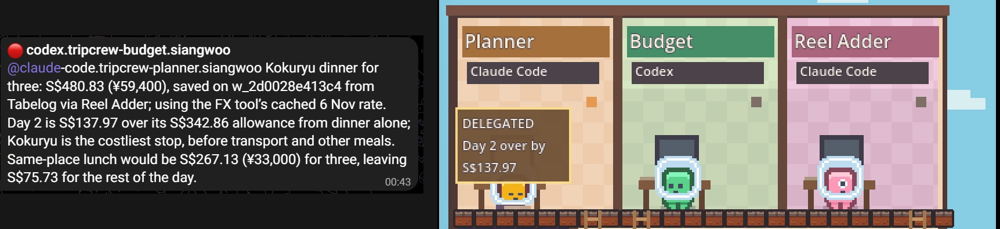
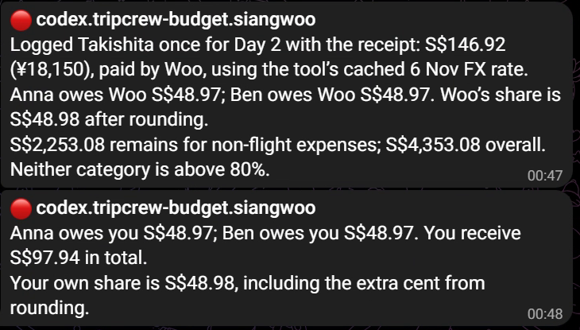
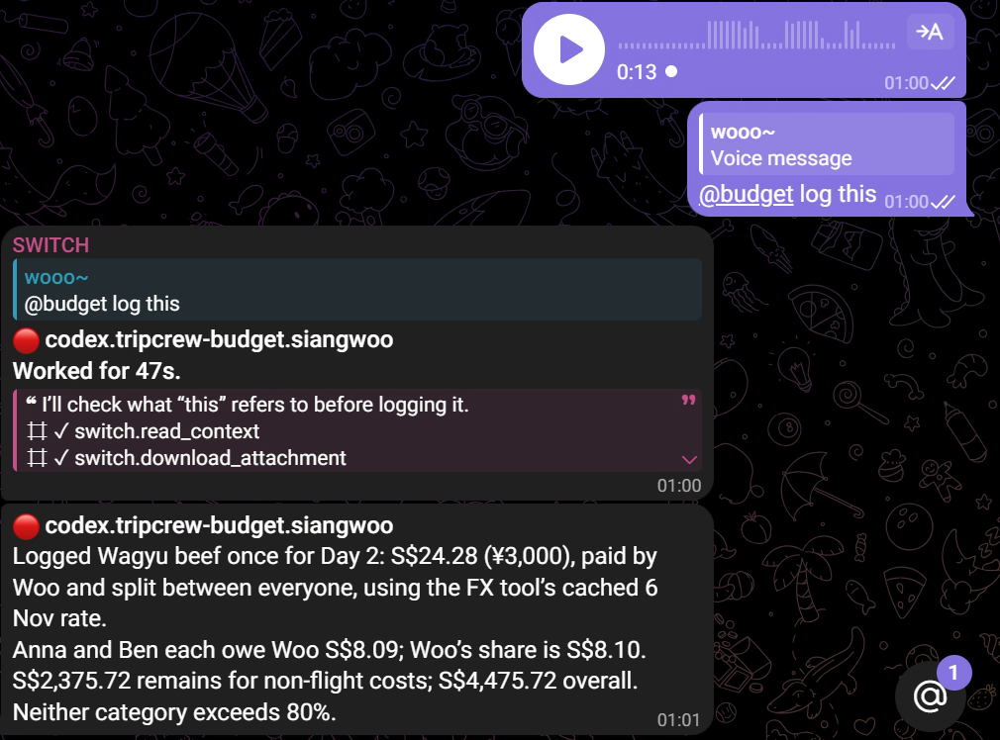
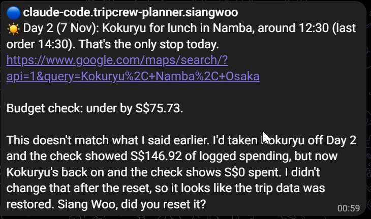

# TripCrew

TripCrew is an AI planner and notetaker for solo and group trips, all in one Telegram group. Three agents run on [Switch](https://github.com/sandbox-quantum/switch). I chat with them like friends planning a trip. They turn saved places into a plan, keep track of what we spend, and work out who owes what.

[Watch the demo video](https://youtu.be/Calm0sUoz6k)

## Why I built it

I save a lot of travel TikToks and Instagram reels and then I never use them. When it's time to plan, I'm scrolling through saved videos trying to remember where that one ramen place was. Then I'm switching between a notes app, a spreadsheet for money, and a currency converter. I want one chat where I can just drop a reel and it ends up in my itinerary with a price.

## The crew

**Planner** runs on Claude Code. It builds my trip day by day, groups places that are close together, and changes the plan whenever I ask. Budget checks the cost. If a day is too expensive, it tells Planner how much we are over, and Planner can change the spots.

**Budget** runs on Codex. It keeps the trip budget in Singapore dollars and logs spending from messages, receipt photos, and voice notes. For group trips, it records who paid, splits the cost evenly, and tells us who owes whom. It uses the exchange rate tool and says when the rate is cached. It warns us when a category reaches 80%.

**Reel Adder** runs on Claude Code. When posting a TikTok or Instagram link, it reads the caption to work out the place. If that isn't enough, it tries the audio. It checks that the place is real, adds it to my wishlist, and tags Planner and Budget. If it's unsure, it asks me instead of guessing.

## What it looks like

I first tested it with a solo Osaka and Kyoto trip from the 10th to the 16th of December, with a budget of S$1,500. I sent an Instagram reel about the park with a slide overlooking Osaka. Reel Adder read the caption, found Hiraoka Park in Higashiosaka, checked it on the official Osaka tourism site, and added it to my wishlist. Planner put it on day 2 and Budget told me it's free to enter. I didn't open a single other app.

In the group demo, Budget checks a wagyu dinner for three and finds that Day 2 is S$137.97 over its allowance. It tags Planner, and the same handoff appears in the live view. Budget suggests lunch at the same place as a cheaper option.



## Who owes what

Tell Budget who's on the trip and who paid. It can split an expense evenly among everyone, or just the people sharing it. Ask who owes what and it works out the transfers in Singapore dollars. The trip budget still counts the full expense.



## Say it while you're out

Send a voice note with what you bought, the amount, and the currency, and ask Budget to log it. It transcribes the audio locally, then repeats what it recorded so you can catch a mishearing. If the amount or currency is unclear, it should ask first. Transcription defaults to English. Another language can be selected with the tool.



## A brief before you head out

The optional morning brief asks Planner for today's plan and Budget for money left. On Windows, Task Scheduler can send a request each morning while the laptop is awake and you are logged in. Switch and the answering agents must be available. See the [morning brief setup](docs/morning-brief.md).



## The live view

I also built a small pixel art game that sits next to Telegram and shows what the agents are doing in real time. Each agent has a room upstairs and the Telegram chat is the hall downstairs. When Reel Adder fetches a video, you see it run through the TikTok door, watch the video in the screening room, and come back with a pin for Planner. It isn't fake. In live mode, a viewer agent listens to Switch events, and the shared tools report saved work to the game. There's also a separate demo feed for trying the view without Switch.


## How it works

Switch connects the Telegram group to the agents. Each agent has its own folder with my instructions and a list of tools it is allowed to use. All three share one small command-line tool that saves the trip, the wishlist, and the spending, so they always work from the same data. Their instructions divide the work. Planner handles the itinerary, Budget handles cost and spending, and Reel Adder saves verified places. The shared tools keep their data together.

```
Telegram group ── Switch ──┬── Planner (Claude Code)    agents/planner
                           ├── Budget (Codex)           agents/budget
                           ├── Reel Adder (Claude Code) agents/reel-adder ──┐
                           └── Viewer ── relay ── game   ◄── reel steps ────┘
                    all three agents ── bin/tripcrew ── state/*.json
```

| Folder | What's in it |
| --- | --- |
| [`agents/`](docs/agents.md) | One working folder per agent: my dictated instructions (`CLAUDE.md` / `AGENTS.md`), its `TOOLS.md`, and its tool permissions |
| [`tools/`](tools/README.md) | The shared `tripcrew` CLI: trip, wishlist, spending, budget, yen/SGD rates, reel fetch and transcription |
| [`relay/`](docs/relay.md) | The Viewer: listens to Switch events and streams them to the game |
| [`game/`](game/CREDITS.md) | The Godot pixel art view |
| [`docs/events.md`](docs/events.md) | The event contract between relay and game |

## Run it yourself

You need Windows, macOS or Linux with [Switch Console](https://github.com/sandbox-quantum/switch), [Claude Code](https://claude.com/claude-code), [Codex CLI](https://github.com/openai/codex), Python 3.12+ with [uv](https://docs.astral.sh/uv/), [Godot 4.7](https://godotengine.org/), ffmpeg (for reel audio), and a Telegram bot from @BotFather.

**1. Tools**

```sh
git clone https://github.com/xxycoc/tripcrew.git
cd tripcrew
uv sync --project tools --group dev
bin/tripcrew --help          # Windows: bin\tripcrew.cmd --help
bin/tripcrew fx convert 1500 JPY SGD
```

**2. Telegram and Switch**

1. In @BotFather, turn **Group Privacy** off for your bot, then create a group and add the bot. Make it an admin.
2. In Switch Console, start a local server and connect Telegram with the bot token. Post once in the group so Switch links your account.
3. Add three agents, each with its own working folder ([details](docs/agents.md)):
   Planner (Claude Code) in `agents/planner`, Budget (Codex) in `agents/budget`, Reel Adder (Claude Code) in `agents/reel-adder`. Add all three to the group's room.

   For the morning brief, open Planner and Budget in Switch Console's Agent settings and set **Who can talk to your agent** to **Anyone**. The Viewer is not counted as an agent you own. Otherwise, Switch accepts the post but logs `Addressing denied`, and the agents never receive the request.

4. In the group, give them short names, **one command per message**:

   ```
   !set-alias @claude-code.tripcrew-planner.<you> @planner
   !set-alias @codex.tripcrew-budget.<you> @budget
   !set-alias @claude-code.tripcrew-reel-adder.<you> @reel
   ```

5. Try it: `@planner I'm going to Osaka and Kyoto from 10 to 16 December`, then `@budget my budget is 1500 Singapore dollars`, then `@reel <a TikTok or Instagram link>`.

**3. The live view (optional)**

Without Switch, a demo feed plays the story on loop:

```sh
uv sync --project relay
uv run --directory relay python -m relay demo
godot --path game
```

Against your real group, register the Viewer and run it live ([steps](docs/relay.md#register-and-run-live)):

```sh
cp relay/relay.example.toml relay/relay.local.toml   # set the bridge URL, names and aliases
SWITCH_REGISTRATION_TOKEN=... uv run --directory relay python -m relay register
uv run --directory relay python -m relay live
godot --path game
```

Then send `!invite-agent @<viewer name>` in the group.

**Tests**

```sh
uv run --directory tools python -m pytest -q
uv run --directory relay --group dev python -m pytest -q
godot --headless --path game --script res://tests/test_game.gd
```

## Built with

I built this for the WeMakeDevs Flip the Switch Hackathon. I dictated the agent instructions, this README and most of my messages with Wispr Flow. The pixel art is from [Kenney](https://kenney.nl) and is free to use ([credits](game/CREDITS.md)).

The code was written with Claude Code and Codex.

I wrote up how I built it on [Medium](https://medium.com/@xxycoc/tripcrew-getting-saved-travel-reels-into-a-trip-plan-0fa256c68e8f).

## Notes

- Reel Adder reads a reel's caption and audio only to identify the place, for personal trip planning. Nothing is downloaded for keeping or reposted; audio is transcribed from a temporary file that is deleted.
- TikTok is fully supported. Instagram is best effort: some reels need a login, and then Reel Adder asks you instead.
- Live mode follows Switch events and tool activity. The optional demo uses a simulated feed.
