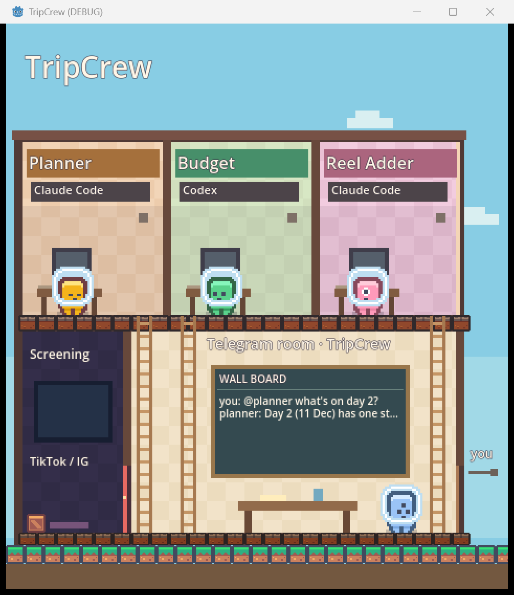

# TripCrew

TripCrew is my travel crew that lives in one Telegram group. It's just me and three AI agents running on [Switch](https://github.com/sandbox-quantum/switch). I chat with them like I do chat with friends planning a trip, and they each handle their own part.

## Why I built it

I save a lot of travel TikToks and Instagram reels and then I never use them. When it's time to plan, I'm scrolling through saved videos trying to remember where that one ramen place was. Then I'm switching between a notes app, a spreadsheet for money, and a currency converter. I want one chat where I can just drop a reel and it ends up in my itinerary with a price.

## The crew

**Planner** runs on Claude Code. It builds my trip day by day, groups places that are close together, and changes the plan whenever I ask. It never talks about money. That's Budget's job.

**Budget** runs on Codex. It keeps my budget in Singapore dollars, logs what I spend, converts yen with the live exchange rate, and warns me when a category goes past 80%.

**Reel Adder** runs on Claude Code. When I post a TikTok or Instagram link, it fetches the video and works out the place from the caption, or from the audio if the caption isn't enough. It checks that the place is real, adds it to my wishlist, and tags Planner and Budget. If it's unsure, it asks me instead of guessing.

## What it looks like

My test trip is Osaka and Kyoto, the 10th to the 16th of December, with a budget of S$1,500. I sent an Instagram reel about the park with a slide overlooking Osaka. Reel Adder read the caption, found Hiraoka Park in Higashiosaka, checked it on the official Osaka tourism site, and added it to my wishlist. Planner put it on day 2 and Budget told me it's free to enter. I didn't open a single other app.

## The live view

I also built a small pixel art game that sits next to Telegram and shows what the agents are doing in real time. Each agent has a room upstairs and the Telegram chat is the hall downstairs. When Reel Adder fetches a video, you see it run through the TikTok door, watch the video in the screening room, and come back with a pin for Planner. It isn't fake. A viewer agent listens to the real Switch events, and the game only moves when something actually happens.



## How it works

Switch connects the Telegram group to the agents. Each agent has its own folder with my instructions and a list of tools it is allowed to use. All three share one small command-line tool that saves the trip, the wishlist, and the spending, so they always work from the same data. Each agent can only change its own part.

```
Telegram group ── Switch ──┬── Planner (Claude Code)    agents/planner
                           ├── Budget (Codex)           agents/budget
                           ├── Reel Adder (Claude Code) agents/reel-adder ──┐
                           └── Viewer ── relay ── game   ◄── reel steps ────┘
                    all three agents ── bin/tripcrew ── state/*.json
```

| Folder | What's in it |
| --- | --- |
| [`agents/`](docs/agents.md) | One working folder per agent: my dictated instructions (`CLAUDE.md` / `AGENTS.md`), its `TOOLS.md`, and its tool permissions |
| [`tools/`](tools/README.md) | The shared `tripcrew` CLI: trip, wishlist, spending, budget, yen/SGD rates, reel fetch and transcription |
| [`relay/`](docs/relay.md) | The Viewer: listens to Switch events and streams them to the game |
| [`game/`](game/CREDITS.md) | The Godot pixel art view |
| [`docs/events.md`](docs/events.md) | The event contract between relay and game |

## Run it yourself

You need Windows, macOS or Linux with [Switch Console](https://github.com/sandbox-quantum/switch), [Claude Code](https://claude.com/claude-code), [Codex CLI](https://github.com/openai/codex), Python 3.12+ with [uv](https://docs.astral.sh/uv/), [Godot 4.7](https://godotengine.org/), ffmpeg (for reel audio), and a Telegram bot from @BotFather.

**1. Tools**

```sh
git clone https://github.com/xxycoc/tripcrew.git
cd tripcrew
uv sync --project tools --group dev
bin/tripcrew --help          # Windows: bin\tripcrew.cmd --help
bin/tripcrew fx convert 1500 JPY SGD
```

**2. Telegram and Switch**

1. In @BotFather, turn **Group Privacy** off for your bot, then create a group and add the bot. Make it an admin.
2. In Switch Console, start a local server and connect Telegram with the bot token. Post once in the group so Switch links your account.
3. Add three agents, each with its own working folder ([details](docs/agents.md)):
   Planner (Claude Code) in `agents/planner`, Budget (Codex) in `agents/budget`, Reel Adder (Claude Code) in `agents/reel-adder`. Add all three to the group's room.
4. In the group, give them short names, **one command per message**:

   ```
   !set-alias @claude-code.tripcrew-planner.<you> @planner
   !set-alias @codex.tripcrew-budget.<you> @budget
   !set-alias @claude-code.tripcrew-reel-adder.<you> @reel
   ```

5. Try it: `@planner I'm going to Osaka and Kyoto from 10 to 16 December`, then `@budget my budget is 1500 Singapore dollars`, then `@reel <a TikTok or Instagram link>`.

**3. The live view (optional)**

Without Switch, a demo feed plays the story on loop:

```sh
uv sync --project relay
uv run --directory relay python -m relay demo
godot --path game
```

Against your real group, register the Viewer and run it live ([steps](docs/relay.md#register-and-run-live)):

```sh
cp relay/relay.example.toml relay/relay.local.toml   # set the bridge URL, names and aliases
SWITCH_REGISTRATION_TOKEN=... uv run --directory relay python -m relay register
uv run --directory relay python -m relay live
godot --path game
```

Then send `!invite-agent @<viewer name>` in the group.

**Tests**

```sh
uv run --directory tools python -m pytest -q
uv run --directory relay --group dev python -m pytest -q
godot --headless --path game --script res://tests/test_game.gd
```

## Built with

I built this for the WeMakeDevs Flip the Switch Hackathon. I dictated the agent instructions, this README and most of my messages with Wispr Flow. The pixel art is from [Kenney](https://kenney.nl) and is free to use ([credits](game/CREDITS.md)).

The code was written with Claude Code and Codex.

## Notes

- Reel Adder reads a reel's caption and audio only to identify the place, for personal trip planning. Nothing is downloaded for keeping or reposted; audio is transcribed from a temporary file that is deleted.
- TikTok is fully supported. Instagram is best effort: some reels need a login, and then Reel Adder asks you instead.
- The live view only shows real events. It never invents activity.
